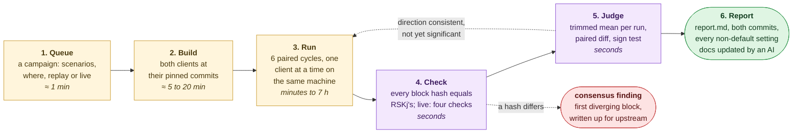
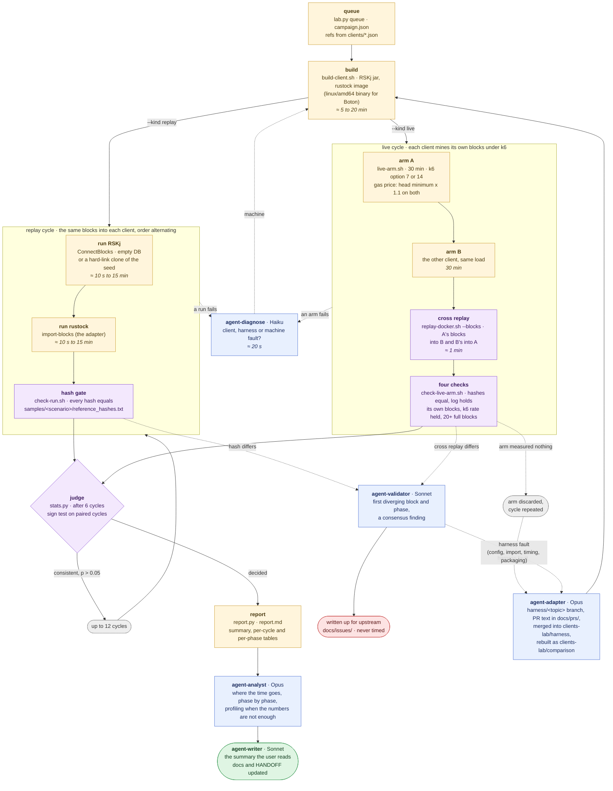

# rsk-clients-lab

Compares the block processing time of two RSK clients on the same workloads:

- **RSKj** at the head of the ref in `clients/rskj.json`, the integration branch of the lab's RSKj fork;
- **rustock**, the same client written in Rust, from [SergioDemianLerner/rustock](https://github.com/SergioDemianLerner/rustock), a fork well ahead of [rustock-rs/rustock](https://github.com/rustock-rs/rustock).

The lab measures. It does not optimize either client.

## In one picture



Scripts run the campaign and decide; an AI reads the result, explains it and writes it up.
A replay campaign on the Mac takes minutes (the mainnet seed) to three hours (both
scenarios from an empty database); a live campaign about seven hours. A campaign is kept only
when both clients computed the same blocks: a different hash stops it, and the finding goes
upstream before any speed is reported.

```bash
bin/lab.py queue --where docker --scenarios ecdsa,mainnet-sim     # a replay campaign
bin/lab.py queue --kind live --scenarios ecdsa@mainnet --cycles 6  # a live one on the mainnet seed
bin/start.sh                                                       # run the queue, detached
bin/lab.py status [id]                                             # where it is
```

## Method

Each campaign replays the same blocks into both clients, one client at a time, from an empty
database. The blocks were mined by RSKj under k6 load, so the workload is inside them and both
clients execute identical transactions:

| Scenario | Blocks | Workload |
|---|---|---|
| `mainnet-sim` | 1..1159 | k6 option 14: storage writes, ERC-20, native transfers and calldata-heavy rollup txs, about 164 txs per block |
| `ecdsa` | 1..207 | k6 option 7: signature-recovery-heavy contract calls |

RSKj replays with `ConnectBlocks`; rustock with `import-blocks`, which the harness adapter adds
(see "The rustock adapter"). Both log one line per block in RSKj's format,
`block connect breakdown best: block=… hash=… totalMs=… executeMs=… …`, so one analyzer reads
both. `docs/timing-scope.md` maps each client's phases and states what `totalMs` covers in each.

A run counts only if every block was imported with exactly RSKj's reference hashes. A mismatch
stops the campaign and is reported as a consensus finding about rustock.

A cycle is one run of each client, the order alternating between cycles. A campaign runs 6
cycles per scenario (up to 12 when the direction is consistent but not yet significant), and
judges with the statistics RSKj's own A/B benchmarks use: per run, the 10% trimmed mean of per-block `totalMs` over
the blocks at least 90% full, with the plain mean and median beside it; per cycle, the paired
difference; across cycles, the exact sign test. The verdict is "rustock faster", "rustock slower"
or "no difference", with the minimum difference set per scenario in `config.json`.

| Where | How |
|---|---|
| Docker, this Mac | each client in its own container with the same CPU and memory limits and a fresh data volume |
| Boton, boxes A and B | native binaries (RSKj jar, rustock built for linux/amd64 in Ubuntu 22.04), counterbalanced: one slot runs RSKj on A and rustock on B, the next swaps them |

One node per machine at a time. This Mac's Docker VM and the Boton boxes may be shared with
other labs through the locks in `~/.research-lab/locks`; the protocol is in `bin/lib.sh`.

## Live mining

A live campaign (`bin/lab.py queue --kind live`) has each client mine its own blocks instead
of replaying a sample: one 30-minute arm per client per cycle, in Docker on this Mac, the node
under the scenario's k6 load (option 14 for `mainnet-sim`, 7 for `ecdsa`) from an empty
database or a clone of the mainnet seed (`mainnet-sim@mainnet`, `ecdsa@mainnet`). RSKj runs
through the runtime image's entrypoint (timed mining at a 10 s median, 2 CPUs); rustock runs
`live_args` from `clients/rustock.json`, which need the adapter's timed miner, mined-block
timing line and block export (`docs/live-mining-plan.md`). The hash gate becomes four checks
(`bin/check-live-arm.sh`): the arm's blocks replay into the other client with the same hashes
(the cross replay, through `bin/replay-docker.sh --blocks`), the log holds exactly the arm's
own blocks, the k6 success rate held, and at least 20 blocks were at least 90% full after the
first 20. The statistic and the verdict are the ones above; `report.md` adds a per-arm table
with blocks mined, qualifying blocks, transactions, k6 success rate and the cross-replay
result, since the two arms of a cycle mine different blocks. Boton live slots are a later step.

Out of scope, because rustock cannot do it yet: the mainnet database (it cannot read RSKj's;
`docs/mainnet-db-plan.md` converts a copy).

## How a campaign moves



Yellow: a script runs it. Purple: a script decides. Blue: a Claude agent
(`.claude/agents/`), with its model. Green: the result the user reads. Red: a consensus
finding, which is never timed. Dotted: a way back or out. `bin/lab.py` drives every step;
one cycle holds the machine's lock from its first run to its last check, so another lab's
short jobs may run between cycles but never inside one. On Boton the replay cycle is a slot:
RSKj on box A and rustock on box B, the next slot swapped (`bin/boton-campaign.sh`); live
cycles run on this Mac only.

## The rustock adapter

rustock needs small harness-only changes to be measured, each proposed upstream as a pull
request to the SergioDemianLerner fork from a branch in `clients/rustock`:

1. a regtest chain from a genesis file with RSKj's activation heights and REMASC constants;
2. `import-blocks --file`, through the same validation and execution path as sync;
3. the per-block timing line;
4. a multi-arch Dockerfile and the linux/amd64 build for Boton.

Until they merge, `clients-lab/harness` holds the merge of all four. The lab builds
`clients-lab/comparison`, which tracks that merge and holds comparison-only instrumentation.
Every report names the commit. No adapter change may touch what the client computes or how fast.

## Layout

| Path | What |
|---|---|
| `clients/rskj`, `clients/rustock` | submodules; `clients/<name>.json` describes how each is built and run |
| `conf/` | genesis and RSKj node config; `rustock-wallet.keys`, the ten regtest keys k6 sends from in live arms |
| `database-seed/`, `k6-tests/` | submodules: the mainnet seed tooling (rsk-database-seed, driven through `bin/seed.sh`) and the k6 suite (rskj-k6-tests) |
| `docker/` | the rustock build image and the RSKj runtime image (`docker/runtime/Dockerfile`) |
| `samples/<scenario>/` | block file (gitignored), reference hashes, `meta.json` with its sha256 |
| `bin/` | `build-client.sh`, `replay-docker.sh`, `live-arm.sh`, `import-sample.sh`, `with-lock.sh`, stats and analyzer |
| `docs/` | timing scope, adapter pull request descriptions |
| `campaigns/<date>-<id>/` | a campaign's report (raw data under `raw/`, not committed) |
| `state/` | builds, runs, logs (gitignored) |

## Commands

```bash
bin/build-client.sh rskj "$(jq -r .ref clients/rskj.json)"   # -> state/builds/rskj-<sha>.jar
bin/build-client.sh rustock clients-lab/comparison linux-arm64
bin/replay-docker.sh rskj state/builds/rskj-<sha>.jar ecdsa state/runs/try-rskj
bin/live-arm.sh rskj state/builds/rskj-<sha>.jar ecdsa state/runs/live-rskj   # one 30-minute live arm
bin/with-lock.sh <command>                                # run anything heavy in the shared Docker slot
```
